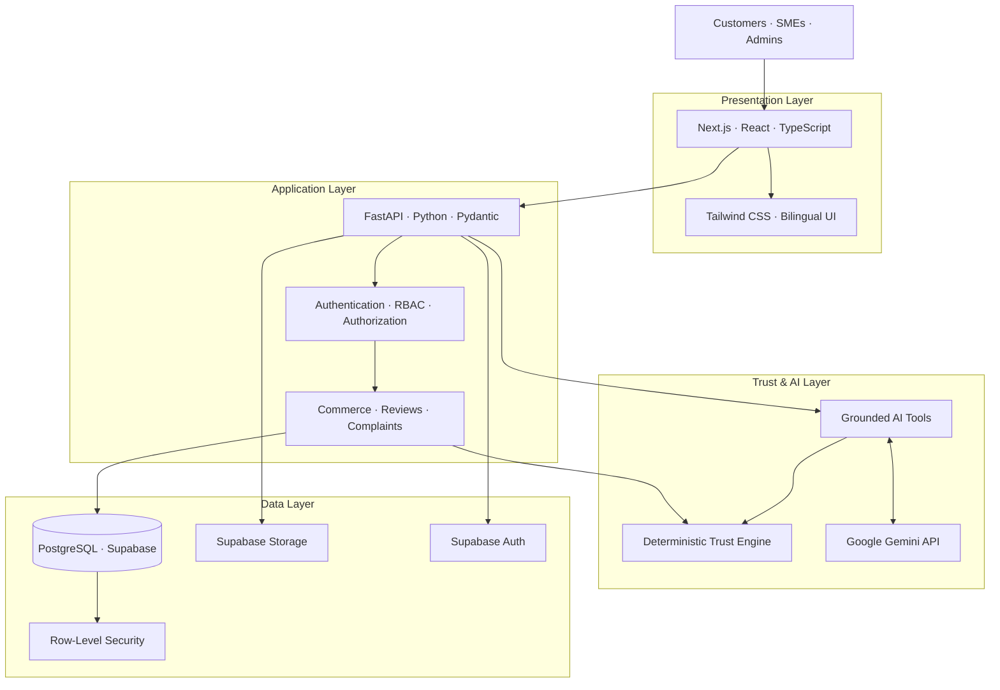
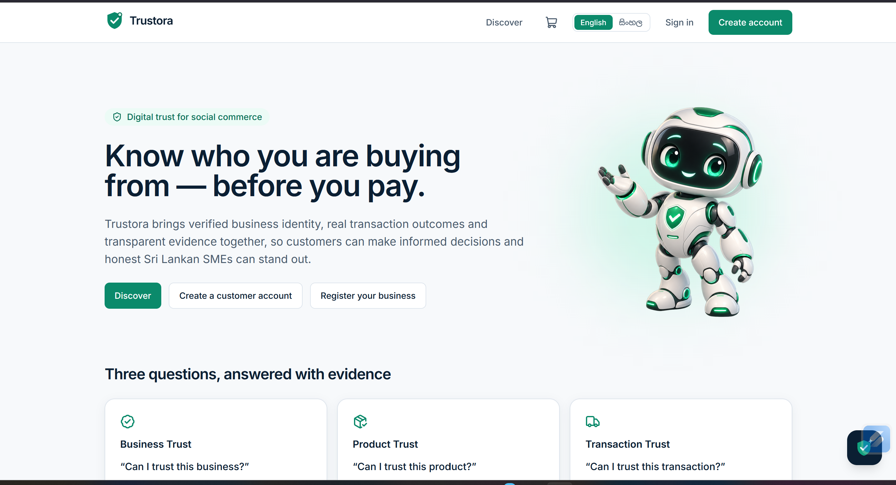
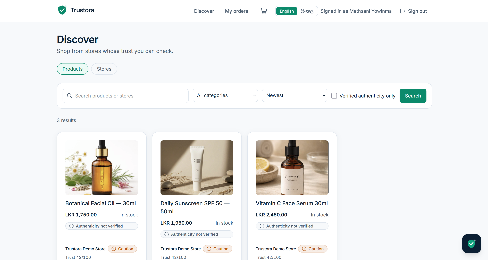
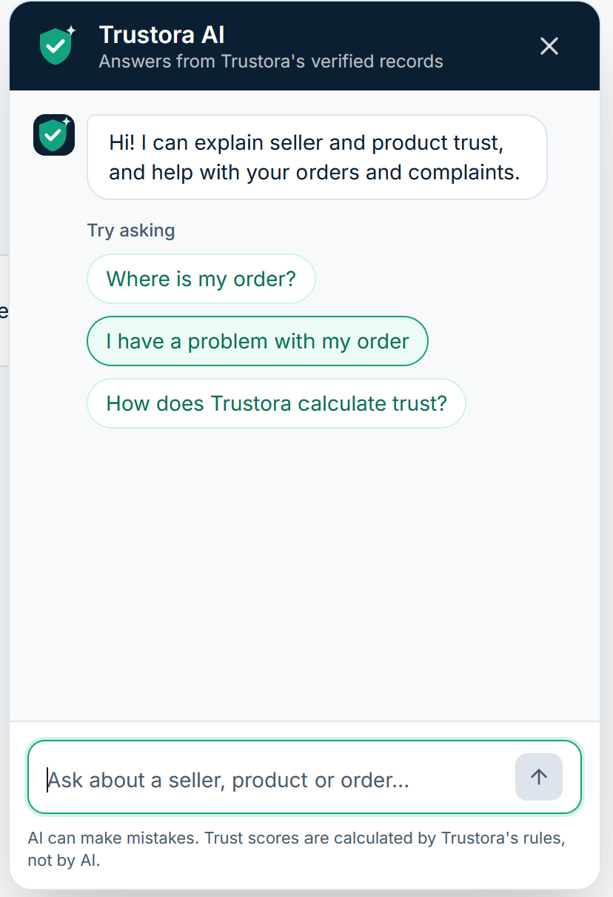
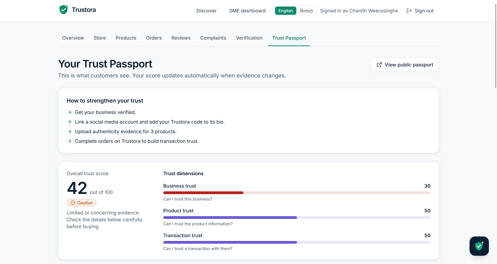

# 🛡️ Trustora
### Digital Trust Infrastructure for Social Commerce

**Trust. Verify. Shop.**

> Making online commerce more transparent, one trusted interaction at a time.

  <a href="https://trustora-dusky.vercel.app/"><strong>🌐 Live Application</strong></a>
  &nbsp; • &nbsp;
  <a href="https://github.com/methsani-yowinma/trustora"><strong>💻 Source Code</strong></a>

---

## 🌱 The Vision

**What if customers could evaluate a business before trusting it with their money?**

Social commerce has made it easier than ever for small businesses to reach customers. But buying through Instagram, TikTok, Facebook, and other social platforms can leave customers with unanswered questions:

- Is this business legitimate?
- Can I trust the product information?
- What do previous customer experiences reveal?
- How have complaints been handled?
- What evidence supports a seller's trustworthiness?

Traditional star ratings rarely tell the whole story.

**Trustora is my solution to this problem.**

I independently designed, architected, developed, tested, and deployed a full-stack digital trust and social-commerce platform that brings business information, customer experiences, structured evidence, and AI-assisted insights into one place.

Rather than allowing an AI model to decide whether a business is trustworthy, Trustora combines **deterministic trust scoring, evidence-based signals, secure application workflows, and grounded AI assistance** to help customers make more informed purchasing decisions.

---

## ✨ What Makes Trustora Different?

| Capability | What it does |
|---|---|
| 🛡️ Digital Trust Passport | Presents structured trust information about businesses using available evidence and trust signals. |
| ⚖️ Deterministic Trust Engine | Calculates trust scores through predefined rules rather than asking an LLM to invent a score. |
| 🏪 SME Storefronts | Enables small businesses to establish digital storefronts and manage product information. |
| 🛍️ Commerce Workflows | Supports product discovery, shopping carts, checkout, orders, and delivery-status workflows. |
| 🧾 Reviews & Complaints | Connects customer feedback with relevant business, product, transaction, and evidence workflows. |
| 🧠 Trustora AI | Uses Google Gemini for grounded assistance, review and complaint analysis, information extraction, and trust explanations. |
| 🌐 Bilingual Experience | Supports English and Sinhala experiences for the Sri Lankan social-commerce context. |
| 🔐 Security-Conscious Design | Uses authentication, role-based access, database-level access policies, and server-side handling of privileged operations. |

---

## 🧠 Engineering Philosophy: AI Assists. Rules Decide.

One of the most important design decisions in Trustora is separating generative AI from deterministic business logic.

An LLM can interpret text, summarise evidence, and assist users. However, it should not arbitrarily generate a business's final trust score.

Trustora separates these responsibilities:

- **Google Gemini:** Language understanding, classification, information extraction, summarisation, and tool-assisted responses.
- **Trust Engine:** Deterministic, rules-based trust calculations.
- **FastAPI backend:** Business logic, data retrieval, authorization, and application workflows.
- **PostgreSQL:** Persistent structured records and database-level access enforcement.

This approach improves consistency, explainability, and auditability while reducing the risk of hallucinated trust scores.

---

## 🏗️ System Architecture

Trustora uses a layered architecture that separates the user interface, application logic, database, trust calculations, and AI integration.

### Architecture at a glance

**Frontend:** Next.js and TypeScript deliver the customer-facing experience, storefronts, trust information, commerce workflows, and AI assistant.

**Backend:** FastAPI handles API requests, application services, authorization, trust-related workflows, and AI orchestration.

**Trust engine:** A rules-based component evaluates predefined trust signals and produces the platform's trust calculations.

**AI integration:** Gemini assists with language-based tasks and grounded interactions through backend capabilities.

**Data infrastructure:** Supabase provides PostgreSQL, authentication, storage, and database security policies.

**Deployment:** The frontend is deployed on Vercel, while the backend runs on Railway.

---

## 🧰 Technology Stack

### Frontend
- Next.js
- React
- TypeScript
- Tailwind CSS

### Backend
- Python
- FastAPI
- Pydantic
- RESTful APIs

### Database & Authentication
- PostgreSQL
- Supabase
- Supabase Auth
- Supabase Storage
- Row-Level Security (RLS)
- Database migrations

### Artificial Intelligence
- Google Gemini API
- Function/tool calling
- Grounded AI responses
- Review and complaint analysis
- Information extraction and summarisation
- AI guardrails and prompt-injection mitigation

### Security & Engineering
- Role-Based Access Control (RBAC)
- Server-side privileged operations
- Database access policies
- Audit mechanisms
- Automated testing
- Environment-based configuration

### Deployment & Version Control
- Vercel
- Railway
- Git
- GitHub

---

## 🔐 Security by Design

Trust is not just a feature in Trustora. It is also an engineering requirement.

### Identity and access control

Supabase Auth handles authentication, while role-based permissions distinguish between customers, SMEs, and administrators.

### Database-level protection

PostgreSQL Row-Level Security policies provide database-level access controls. Sensitive domain operations are routed through the backend, keeping privileged service credentials away from the browser.

### AI safety boundaries

The AI assistant is designed to operate through controlled backend capabilities, use authorised information, and avoid inventing trust scores or making unsupported claims about businesses.

### Separation of responsibilities

Trust-related calculations remain deterministic, while Gemini supports language-based analysis. This reduces reliance on generative output for consequential application decisions.

### Evidence and accountability

Structured reviews, complaints, transactions, and verification signals provide evidence for trust-related workflows, supported by audit mechanisms.

**Security principle:** AI-generated text is not automatically authoritative evidence, and an AI assistant must not bypass the application's authorization rules.

---

## 🛒 Core User Journeys

### For customers
1. Discover businesses and browse products.
2. Examine a business's Digital Trust Passport.
3. Review available trust information and customer feedback.
4. Add products to a cart and proceed through checkout.
5. Follow order and delivery-status workflows.
6. Submit reviews, complaints, and supporting evidence.
7. Ask Trustora AI for relevant platform information and explanations.

### For SMEs
1. Register and establish a business profile.
2. Create a storefront and manage products.
3. Manage orders and related business workflows.
4. Participate in business verification processes.
5. Build a more transparent record of customer experiences and trust signals.

### For AI-assisted interactions
1. A user submits a question.
2. The AI determines the relevant supported action.
3. Backend tools retrieve information within authorization boundaries.
4. Trust calculations remain under the deterministic engine.
5. Gemini produces a grounded explanation based on the available result.

---

## 🧪 Testing & Quality Assurance

Trustora includes automated backend and frontend tests to validate application behaviour and reduce regressions.

Testing covers areas such as:

- Backend business logic and API behaviour
- Trust-related calculations
- Authentication and authorization boundaries
- Reviews, complaints, and commerce workflows
- AI assistant behaviour and safety scenarios
- Frontend components and application functionality

The project has undergone extensive automated testing during development. Test totals should be updated to reflect the latest verified run.

---

## ☁️ Deployment Architecture

| Component | Platform | Responsibility |
|---|---|---|
| Frontend | Vercel | Next.js application hosting |
| Backend | Railway | FastAPI application hosting |
| Database | Supabase | PostgreSQL and structured application data |
| Authentication | Supabase Auth | User identity and authentication |
| Storage | Supabase Storage | Application file storage |
| AI | Google Gemini API | AI-assisted analysis and conversations |
| Source control | GitHub | Version control and project history |

### Explore the project

- **Live application:** https://trustora-dusky.vercel.app/
- **GitHub repository:** https://github.com/methsani-yowinma/trustora

---

## 👩‍💻 My Role & Ownership

**Individual project — independently developed end to end.**

I was responsible for the product concept, technical decisions, architecture, implementation, testing, security hardening, and deployment.

My work includes:

- Designing the overall system architecture.
- Developing the frontend and backend.
- Designing database structures and access policies.
- Implementing deterministic trust-scoring workflows.
- Integrating Google Gemini into application-specific AI workflows.
- Building commerce, review, complaint, and evidence-related functionality.
- Implementing authentication and role-based access boundaries.
- Testing, debugging, and deploying the application.

This project demonstrates my ability to combine **full-stack engineering, applied AI, database security, and product-oriented problem-solving** in one working application.

---

## 🚀 Future Direction

Potential future enhancements include:

- Expanded adversarial AI testing and automated red-teaming.
- More comprehensive AI security monitoring.
- Improved trust-history visualisation.
- Additional evidence-verification workflows.
- More advanced anomaly detection for suspicious trust signals.
- Further improvements to accessibility and bilingual support.

These are potential extensions, not claims that every capability is already implemented.

---

## 💡 The Bigger Picture

Trustora is built around a simple idea:

**Digital trust should be supported by evidence, not just appearances.**

By combining deterministic decision systems, secure application architecture, and carefully bounded AI assistance, Trustora explores how technology can make social commerce more transparent for customers and more accountable for businesses.

  <strong>Built with purpose. Engineered for trust. 🇱🇰</strong>

## 📸 Product Showcase

### 01. Meet Trustora

Know who you are buying from — before you pay.

### 02. Discover Products & Stores

Explore products, compare listings, and review available trust indicators before making a purchasing decision.

### 03. Trustora AI

An AI-powered assistant that helps users understand trust information and navigate order and complaint workflows, with responses grounded in Trustora's available records.

### 04. Digital Trust Passport

A structured view of business, product, and transaction trust dimensions, supported by the platform's deterministic trust-scoring rules.

---

*Trustora is an independently developed project by Methsani Yowinma.*
